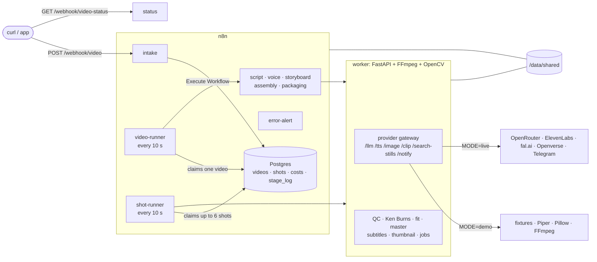

# Architecture

## Components

## A video's life

| status | who moves it | what happens | moves on when |
|---|---|---|---|
| `queued` | video-runner → `script` | the model writes 6-10 paragraphs citing sources; code checks the shape and the citations; one repair round | the script passes the checks |
| `voice` | video-runner → `voice` | each paragraph is spoken, parts are joined with 0.35 s pauses, each paragraph gets a slot on the timeline, subtitles are written | always |
| `storyboard` | video-runner → `storyboard` | the model plans 1-4 shots per paragraph; code fits them to the slots (scales ≤ 15% drift, caps AI time at 30%); one repair round | the plan fits the narration |
| `production` | shot-runner | every shot: picture → image QC → render job → clip QC; three tries, then Ken Burns over the last picture; a shot with no picture at all gives its time to a neighbour | no shot is pending or generating |
| `assembly` | video-runner → `assembly` | music bed, then the master render as a background job, polled on later runs; final QC: length = narration ± 1 s, −14 ± 1 LUFS, no black | final QC passes |
| `packaging` | video-runner → `packaging` | three titles, kept only if their quote is in the script; description with sources and photo credits; thumbnail; notification | always |
| `ready` / `failed` | | a stage that fails three times fails the video, with the reason in `last_error` | |

## Decisions

- **One provider gateway.** n8n never calls a model provider; the worker does. Demo and live differ
  in one place, and every provider call is testable offline. The original pipeline let n8n call
  providers directly, which made a keyless mode impossible.
- **State lives in Postgres, not in executions.** Runners claim work with `FOR UPDATE SKIP LOCKED`
  and a lock timeout, so a crashed run frees its video, and several n8n workers would not collide.
- **Decisions are code, wiring is n8n.** Every rule (script checks, storyboard fitting, the shot state
  machine, stage retries, titles) is a TypeScript module with unit tests, bundled into a Code node by
  the kit. Glue Code nodes only reshape data.
- **Transitions never shorten the timeline.** A crossfade borrows its time from an extended clip, so
  picture and narration end together; QC checks it.
- **Loudness is linear.** Two-pass loudnorm with a limiter placed exactly where the gain will put the
  peaks, so speech reaches −14 LUFS without pumping.
- **Renders are jobs.** Long work runs in the worker's background jobs, with heartbeat files; a job
  whose process died is reported as failed instead of hanging forever.
